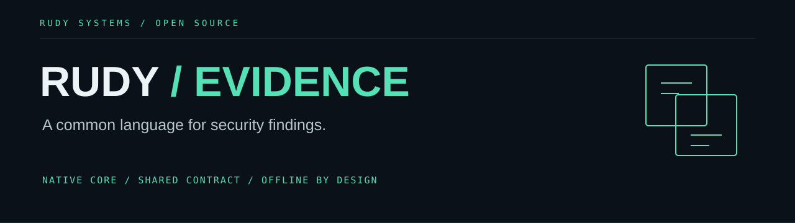

<p align="center"></p>

<p align="center">
<a href="https://github.com/r4venrudy/rudy-evidence/actions/workflows/ci.yml"></a>


<a href="LICENSE"></a>
</p>

**One evidence pipeline for security tools written in different languages.** Embed a native C++20 library, call its C ABI from C# or Python, or use the offline CLI. Normalize scanner findings, remove recognized secret patterns, preserve scoped identities, compare baselines and export SARIF.

**0.1.0 developer preview.** The contract is versioned; independent security review and broad compatibility testing are still ahead. This is a finding-processing library, not a detection engine or an established industry standard.

## Why it exists

A scanner result, an endpoint alert and an analyst's finding should not require three incompatible reporting pipelines. Rudy Evidence gives applications a small shared core with explicit semantics: identity includes the project or host scope, duplicate findings combine deterministically, and a finding missing from a later report is **absent**, never automatically fixed.

```text
Semgrep · Nuclei · Trivy · SARIF · Web Audit · Sentinel · Native
                              │
                    C++20 evidence core
                              │
             Canonical bundle → compare → SARIF
                              │
                     C · C# · Python · CLI
```

| Capability | Behavior |
| :--- | :--- |
| Scoped identity | BLAKE3 fingerprint over scope, producer, rule, asset and location; triage changes retain identity |
| Deterministic merge | Exact identity deduplication, highest severity, sorted evidence and identifiers |
| Baselines | Added, changed, unchanged and absent findings, with both bundle digests |
| Redaction | Built-in key and token patterns applied before and after adapter extraction |
| Integrity | Canonical bundle consistency checks using the official BLAKE3 implementation |
| Interoperability | Seven adapters, SARIF export, C ABI ownership rules, C# and Python bindings |
| Bounded processing | Request/output size, depth, node, key, finding and evidence-list limits |
| Offline builds | Pinned, vendored JSON and BLAKE3 sources; no runtime network access |

## Build and try it

Requires CMake 3.24+, a C++20 compiler and Python 3.10+ for development tests. Builds do not download dependencies.

```sh
cmake -S . -B build -DCMAKE_BUILD_TYPE=Release
cmake --build build --config Release --parallel
ctest --test-dir build -C Release --output-on-failure
cmake --install build --config Release --prefix install
```

The installed executable is `install/bin/rudy-evidence` (`.exe` on Windows). Examples below use a single-configuration build. With Visual Studio, use `build/Release/rudy-evidence.exe`.

```sh
build/rudy-evidence normalize semgrep repo:example examples/semgrep.json > findings.json
build/rudy-evidence validate findings.json
build/rudy-evidence sarif findings.json > findings.sarif
build/rudy-evidence diff findings.json findings.json
build/rudy-evidence normalize-lines nuclei site:example scan.jsonl > site.json
build/rudy-evidence merge findings.json site.json > combined.json
```

Scopes are caller-selected stable identifiers, such as a repository URL or a host/boot pair. Different scopes never deduplicate. Keep a scope stable when comparing the same target across runs. A scope label is not evidence of authenticity.

CLI stdout contains JSON only; diagnostics go to stderr. Exit codes: `0` success, `1` rejected input/read error, `2` usage error, `3` internal/output error. Each command accepts `-` for stdin. See [`docs/CONTRACT.md`](docs/CONTRACT.md) for request formats and exact hashing rules, and [`docs/ADAPTERS.md`](docs/ADAPTERS.md) for supported subsets.

## Embed it

### C++

After installing, point `CMAKE_PREFIX_PATH` at the installation prefix:

```cmake
find_package(RudyEvidence 0.1 CONFIG REQUIRED)
target_link_libraries(your_tool PRIVATE RudyEvidence::core)
```

```cpp
#include <rudy/evidence.hpp>
auto bundle = rudy::evidence::process(R"({
  "operation":"normalize", "format":"native", "scope":"repo:example",
  "document":{"findings":[{
    "producer":"my-scanner", "rule_id":"CONFIG.001",
    "title":"Review setting", "severity":"medium",
    "asset":{"kind":"file","id":"config.yml"}
  }]}
})");
```

### C / C# / Python

The shared library exports a length-delimited UTF-8 JSON interface. Both returned buffers belong to the library and must be released with `re_free`; no exceptions cross the C boundary. See [`evidence.h`](include/rudy/evidence.h) and the [C example](examples/consumer/main.c).

```csharp
// Reference bindings/csharp/Rudy.Evidence.csproj.
// Set RUDY_EVIDENCE_LIBRARY to the absolute trusted native library path.
string result = Rudy.Evidence.Evidence.Process(
    "{\"operation\":\"redact\",\"document\":{\"token\":\"example\"}}");
```

```python
# Add bindings/python to your import path; set RUDY_EVIDENCE_LIBRARY.
from rudy_evidence import Evidence
sdk = Evidence()
bundle = sdk.normalize("semgrep", "repo:example", report)
```

The C# project targets .NET 8+. Language bindings load a native library you supply; no NuGet or PyPI package is claimed to be published. C++ static libraries require a compatible compiler/runtime. Use the C ABI across compiler boundaries.

## Trust and privacy

Integrity hashes detect inconsistent content. They do **not** authenticate an author, sign evidence or prove that a scanner ran. An attacker can rewrite a bundle and recompute its hash. Redaction covers documented patterns and can miss secrets or remove innocent text; review exported evidence before sharing it. This library has no network, process-launching, driver-loading or file-writing functions. The CLI reads local inputs and writes stdout.

No CVSS scores are invented. No semantic cross-scanner deduplication is attempted. A report can be partial even when all its findings normalize successfully. See [security boundaries](SECURITY.md).

## Development

The tests exercise adapters, malformed inputs, deterministic identity/merge behavior, redaction, SARIF round trips, C memory ownership and concurrent calls. CI covers Linux, Windows and macOS, C# and Python bindings, installed consumers, sanitizer checks and a bounded fuzz run. Workflow status is the evidence for which CI jobs have passed.

The [recorded Windows synthetic benchmark](docs/benchmark-windows.json) processed 10,000 minimal findings in a median 0.47 seconds across five runs, including process startup and pipe I/O. Reproduce with `python tests/benchmark.py build/rudy-evidence`. This is a workload-specific measurement, not a general throughput guarantee. The optional `tests/sarif_schema.py` check downloads a pinned [official OASIS schema](https://github.com/oasis-tcs/sarif-spec/blob/25eb7663ad3ac54338b4f6a00a7004995e32e6da/sarif-2.1/schema/sarif-schema-2.1.0.json) and requires development dependency `jsonschema==4.25.1`; the core and normal build stay offline.

```sh
python tests/verify_vendor.py
cmake -S . -B build-asan -DRE_SANITIZERS=ON -DCMAKE_BUILD_TYPE=Debug
cmake --build build-asan --parallel
ctest --test-dir build-asan --output-on-failure
```

See [contributing](CONTRIBUTING.md), [architecture](docs/ARCHITECTURE.md), and the [adoption roadmap](docs/ROADMAP.md). MIT licensed. Built by [Rudy Systems](https://rudy.systems) · [r4venrudy](https://github.com/r4venrudy).
